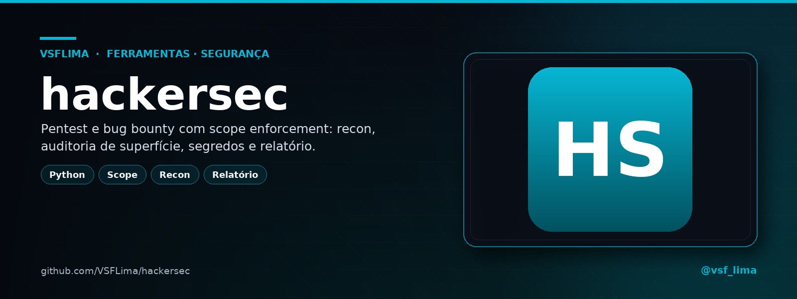
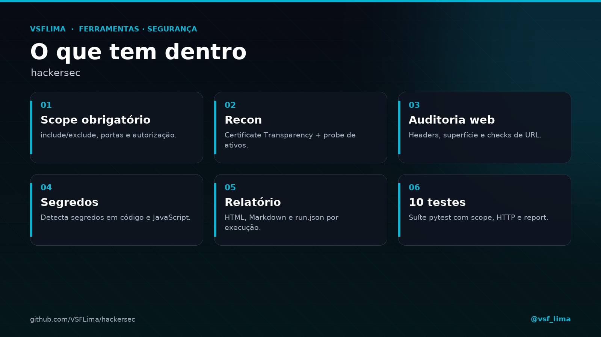

<div align="center">



# 🛡️ hackersec

**Pentest e bug bounty com scope enforcement — nada fora do escopo é tocado.**

CLI em Python que exige um `scope.yaml` assinado, faz recon, audita a superfície web, caça segredos e gera relatório HTML/Markdown/JSON.


[](https://t.me/vsf_lima)

</div>

---

## 📖 Sobre

O **hackersec** é uma CLI de pentest e bug bounty que só toca no que está no `scope.yaml`. O `SafeClient` valida cada requisição contra `include`, `exclude`, portas e extensões permitidas; o que estiver fora do escopo é **bloqueado antes de sair**.

Ele faz **recon** (Certificate Transparency, probe de ativos e auditoria de superfície), **audit** de uma URL, **caça de segredos** em código/JavaScript e gera **relatório HTML, Markdown e JSON** por execução. O `--no-scope` é uma válvula de escape exclusiva para laboratório/CTF com autorização própria.

## ✨ Recursos

| Módulo | O que faz |
|---|---|
| 📜 **Scope obrigatório** | `include`, `exclude`, `allowed_ports`, `deny_extensions` e `authorization` no `scope.yaml`. |
| 🔎 **Recon** | Certificate Transparency + probe de ativos + auditoria de superfície. |
| 🌐 **Audit** | Checa headers, superfície web e respostas de uma URL. |
| 🔑 **Secrets** | Procura segredos em código e JavaScript, com detector genérico opcional. |
| 🚫 **Scope enforcement** | `SafeClient` bloqueia requisições fora do escopo e registra o que foi bloqueado. |
| 📊 **Relatório** | HTML, Markdown (`00-index.md`) e `run.json` com ativos, achados e contagens. |
| 🧪 **Testes** | 10 arquivos de teste (pytest) cobrindo scope, HTTP, engine, checks e report. |

## 🖼️ Prévia

<p align="center">
  
</p>
<p align="center"><em>Scope, recon, auditoria, segredos e relatório.</em></p>

## 🛠️ Stack

- **Linguagem:** Python 3.11+
- **CLI:** argparse (`hackersec`)
- **HTTP:** `requests` + `SafeClient` com rate limit
- **Scope:** `PyYAML`
- **Testes:** `pytest` (+ `pytest-cov`)
- **Relatórios:** HTML, Markdown e JSON

## 📁 Estrutura

```text
.
├── hs/
│   ├── cli.py           # comandos init, recon, audit e secrets
│   ├── engine.py        # orquestra recon, auditoria e findings
│   ├── checks/          # headers e segredos
│   ├── core/            # scope, SafeClient, modelos
│   ├── recon/           # certificate transparency e probe
│   └── report/          # HTML, Markdown e JSON
├── tests/               # 10 arquivos de teste
└── pyproject.toml
```

## 🚀 Instalação

```bash
git clone https://github.com/VSFLima/hackersec.git
cd hackersec
python3 -m venv .venv
. .venv/bin/activate
pip install -e ".[dev]"
hackersec --version
```

## ⚙️ Uso

### 1. Criar o escopo

```bash
hackersec init -o scope.yaml
```

Edite `scope.yaml` com os domínios/IPs autorizados e a autorização:

```yaml
program: "meu-programa"
include:
  - "example.com"
  - "*.example.com"
exclude:
  - "admin.example.com"
allowed_ports: [80, 443, 8080, 8443]
authorization:
  authorized_by: "seu.email@empresa.com"
  reference: "ID-do-programa-ou-contrato"
```

### 2. Rodar o recon

```bash
hackersec recon example.com --scope scope.yaml
hackersec recon example.com --scope scope.yaml --no-ct --no-probe
```

Opções: `--no-ct` (pula Certificate Transparency), `--no-probe` (só passivo), `--no-surface` (pula auditoria de superfície), `--workers` (padrão 10), `--rate` (req/s), `--timeout`, `--insecure`, `-o out`, `--researcher "Nome"`.

### 3. Auditar uma URL

```bash
hackersec audit https://example.com --scope scope.yaml
```

### 4. Procurar segredos

```bash
hackersec secrets ./src --scope scope.yaml
hackersec secrets ./src --scope scope.yaml --no-generic
```

### 5. Relatório

A saída vai para `out/` (ou o diretório passado em `-o`):

| Arquivo | Conteúdo |
|---|---|
| `out/report.html` | relatório visual |
| `out/00-index.md` | índice em Markdown |
| `out/run.json` | ativos, achados, contagens e duração |

## 🧪 Testes

```bash
pytest
```

A suíte cobre scope, `SafeClient`, engine, headers, secrets, modelos e renderização. Os testes marcados como `network` ficam desativados por padrão.

## ⚠️ Escopo e ética

- Use **somente** em programas de bug bounty, contratos ou alvos que você **possui/autorizou por escrito**.
- O `scope.yaml` é obrigatório; sem ele a ferramenta recusa rodar.
- `--no-scope` é apenas para **laboratório/CTF** com autorização própria; nunca em alvo de terceiros.
- Respeite o rate limit e as regras do programa; não faça fuzzing agressivo sem permissão.
- Achados devem ser reportados pelo canal do programa, com evidência mínima e sem expor dados de terceiros.

## 📌 Status

Ferramenta em **v0.1.0**, com 10 arquivos de teste e foco em **scope enforcement**. Repositório privado; não é um scanner de vulnerabilidades completo — é uma base de recon e auditoria para programas autorizados.

## 🙏 Créditos

- **Projeto e código:** VSFLima
- **Distribuição:** [@vsf_lima](https://t.me/vsf_lima)
- **Stack:** Python, `requests`, `PyYAML`, `pytest`

---

<p align="center">Feito por <a href="https://t.me/vsf_lima">@vsf_lima</a> — VSFLima</p>
